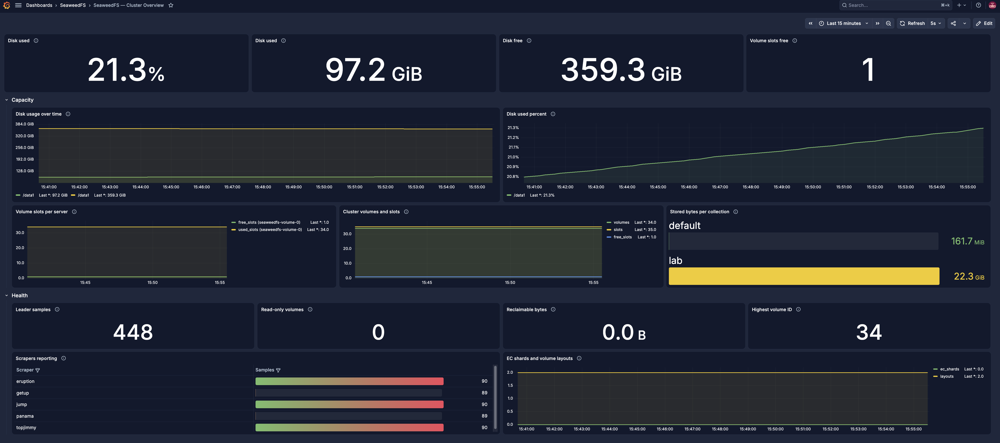
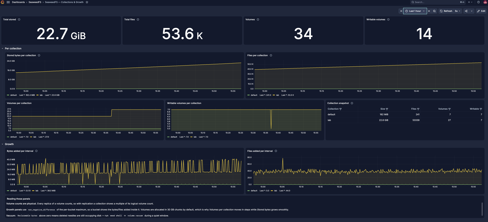

# SeaweedFS lab — object storage with Telegraf and Grafana observability

A small, write-up of a SeaweedFS deployment I run in a home/lab Kubernetes
cluster, together with the monitoring stack built around it: a Telegraf input
plugin for SeaweedFS, an InfluxDB 3 bucket, and three Grafana dashboards
(plus one covering every measurement Telegraf writes).

It is a lab, not a production reference. Everything below is what is actually
deployed and what actually broke; the numbers in the screenshots are real.

> Personal lab notes. Not affiliated with, sponsored by, or endorsed by
> InfluxData or the SeaweedFS project. Product names are used descriptively.





## The stack

| Component | Version | Namespace | Notes |
| --- | --- | --- | --- |
| Kubernetes | v1.35 (5 nodes) | — | kubeadm lab cluster, `local-path` storage |
| SeaweedFS | 4.48 (chart 4.48.0) | `s3` | master, volume, filer + S3, admin, 2 maintenance workers |
| InfluxDB 3 Enterprise | 3.12.1 | `influxdb3` | querier/ingester on `:8181`, bucket `telegraf` |
| Telegraf | 1.40.7 + `inputs.seaweedfs` | `influxdb3` | 5-pod DaemonSet, one pod per node |
| Grafana | 13.2.4 | `grafana` | InfluxQL datasource, three dashboards |

## How it fits together

```
        ┌──────────────────────────── s3 namespace ───────────────────────────┐
        │  seaweedfs-master  :9333        seaweedfs-volume  :8080             │
        │        │  topology, slots               │  /status: disks + volumes │
        │        └──────────────┬────────────────┘                            │
        │  seaweedfs-filer :8888/:8333 (S3)   seaweedfs-worker (vacuum)       │
        └───────────────────────┬─────────────────────────────────────────────┘
                                │  HTTP status APIs (read-only)
                  ┌─────────────▼──────────────┐
                  │ Telegraf DaemonSet (5 pods)│  inputs.seaweedfs
                  │  every node scrapes the    │  + cpu/disk/net/kube_inventory
                  │  same cluster, deduped     │
                  └─────────────┬──────────────┘
                                │  influxdb_v2 line protocol
                  ┌─────────────▼──────────────┐
                  │ InfluxDB 3 Enterprise       │  bucket: telegraf
                  │ querier / ingester :8181    │
                  └─────────────┬──────────────┘
                                │  InfluxQL (HTTP /query)
                  ┌─────────────▼──────────────┐
                  │ Grafana 13                  │  folder: SeaweedFS
                  │  3 dashboards, 38 panels    │
                  └────────────────────────────┘
```

The interesting part is the middle box: SeaweedFS exposes Prometheus metrics on
`:9327`, but they do not include per-disk capacity or per-collection volume and
byte inventory. The Telegraf plugin therefore reads the JSON status APIs
(`master /dir/status`, `volume /status`, `master /cluster/status`), which is where
those numbers actually live.

## Repository layout

```
helm/                 Helm values for all four releases, the Makefile that pins
                      chart versions and checks drift + doc parity, the db3
                      processor patch, and small helpers (slots.py, drift.py)
telegraf-plugin/      the inputs.seaweedfs plugin (source, tests, fixtures, docs)
grafana/              dashboard JSON exports + the import script
docs/rebuild-checklist.md  the verified end-to-end order for an empty cluster
docs/architecture.md  topology, sizing, persistence model, failure domains
docs/deployment.md    build the image, install SeaweedFS, roll out Telegraf
docs/monitoring.md    metrics, dashboards, the Grafana/InfluxDB 3 gotchas
docs/runbook.md       capacity, vacuum, recovery, day-2 operations
docs/storage-growth-and-retention.md
                      the growth investigation, both slot-exhaustion outages,
                      and the 8h retention policy
```

## Quick start

1. **SeaweedFS** — first follow the storage preflight in
   `docs/rebuild-checklist.md`: the values use getup's `/misc` disk plus the
   existing data1 PVC, with 1720 total volume slots and no pod `nodeSelector`.
   The `/misc` boot mount still needs host configuration; a startup guard is
   present, not automatic remounting. Create the three secrets listed at the top of
   `helm/seaweedfs-values.yaml`, then
   `helm install seaweedfs seaweedfs/seaweedfs -n s3 -f helm/seaweedfs-values.yaml`.
2. **Telegraf image** — build Telegraf with the plugin (`docs/deployment.md`),
   push it somewhere your cluster can pull from.
3. **InfluxDB 3** — create the four Secrets it references, then
   `helm install db3 influxdata/influxdb3-enterprise -n influxdb3 -f helm/influxdb3-enterprise-values.yaml`;
   create the `telegraf` database with retention before Telegraf starts.
4. **Telegraf** — `helm install telegraf-ds influxdata/telegraf-ds -n influxdb3 -f helm/telegraf-values.yaml`.

`docs/rebuild-checklist.md` is the full ordered version of the above, including the
steps that bite (pinned chart versions, the database nobody creates, the Grafana
provisioning order).
4. **Grafana** — create the InfluxQL datasource and import the dashboards, or run
   `grafana/build_dashboards.py` which does both (`docs/monitoring.md`).
   `grafana/build_all_measurements_dashboard.py` builds the wider Telegraf
   dashboard, and `grafana/create_slots_alert.py` provisions the capacity alert.
5. **Verify** — `seaweedfs_cluster`, `seaweedfs_disk` and `seaweedfs_collection`
   should appear in the bucket within one collection interval.

## The Telegraf plugin

`telegraf-plugin/` contains a complete Telegraf input plugin:

| Measurement | What it tells you |
| --- | --- |
| `seaweedfs_cluster` | volumes, EC shards, volume slots, servers, layouts |
| `seaweedfs_master` | leader state, highest assigned volume ID |
| `seaweedfs_volume_server` | volumes, EC shards and free slots per server |
| `seaweedfs_disk` | total/used/free bytes and percentages per disk |
| `seaweedfs_collection` | volumes, size, files, deletes per collection |
| `seaweedfs_volume` | optional per-volume detail (`detailed_volumes`) |

It is proposed upstream as a feature request:
[influxdata/telegraf#19971](https://github.com/influxdata/telegraf/pull/19971)
(issue [#19970](https://github.com/influxdata/telegraf/issues/19970)). Until it
merges, the copy here is what the lab runs, compiled into a custom Telegraf image.

## Lessons that cost time

- **Prometheus metrics are not enough for capacity work.** `:9327/metrics` has
  request counters and histograms; disk capacity and collection inventory only
  exist in the JSON APIs.
- **The master reports volume servers as in-cluster addresses.** Outside the
  cluster they do not resolve, so discovery needs an explicit `volume_servers`
  override (port-forward, ingress). A configured server the master does not know
  has no slot information — omit it rather than reporting `0`.
- **Free volume slots are the real capacity limit, not disk bytes.** A volume
  server stops accepting new volumes at `maxVolumes` even with plenty of free
  disk. This lab hit 35/35 at 18 % disk usage: the filer began returning 500 on
  PUT (`No writable volumes and no free volumes left`), and the InfluxDB 3
  ingester — whose WAL and Parquet files live in the `lab` bucket — stopped
  ingesting entirely until `maxVolumes` was raised to 46. The monitor caught it
  (free slots went 21 → 1 → 0) before the writes failed; raising the slot count is
  a Helm value change plus a volume-server restart.
- **`local-path` PVCs are node-local.** A single volume-server replica on
  `local-path` is a single-node failure domain; losing that node means recovering
  volumes by hand (see `docs/runbook.md` for the incident that taught us this).
- **Grafana's InfluxDB SQL mode does not talk to a plaintext querier.** It uses
  Arrow Flight SQL over TLS and fails with `first record does not look like a TLS
  handshake`; InfluxQL mode over HTTP works.
- **InfluxQL mode sends no token by default.** A custom
  `Authorization: Token …` header is required, otherwise every panel reports
  "the request was not authenticated".
- **InfluxDB rejects unsigned integers.** All plugin fields are `int64` bytes.
- **Grafana cannot reduce booleans in a stat panel**, so the leader check counts
  leader samples instead of showing `true`/`false`.
- **A DaemonSet scrapes the same cluster N times.** Five pods, five series sets
  differing only by `host`; the dashboards use `max()`/`min()` so the panels stay
  host-agnostic.

## License and attribution

The documents, Helm values and dashboards in this repository are MIT licensed
(see `LICENSE`). The Telegraf plugin under `telegraf-plugin/` is written against
[Telegraf](https://github.com/influxdata/telegraf) (MIT) and follows its plugin
conventions; [SeaweedFS](https://github.com/seaweedfs/seaweedfs) is Apache-2.0.
No code from either project is vendored here.
