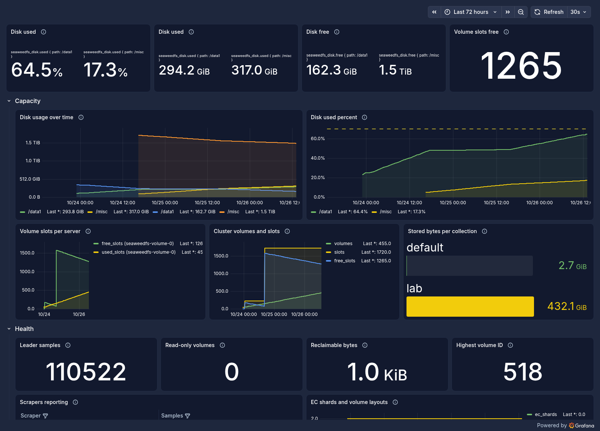
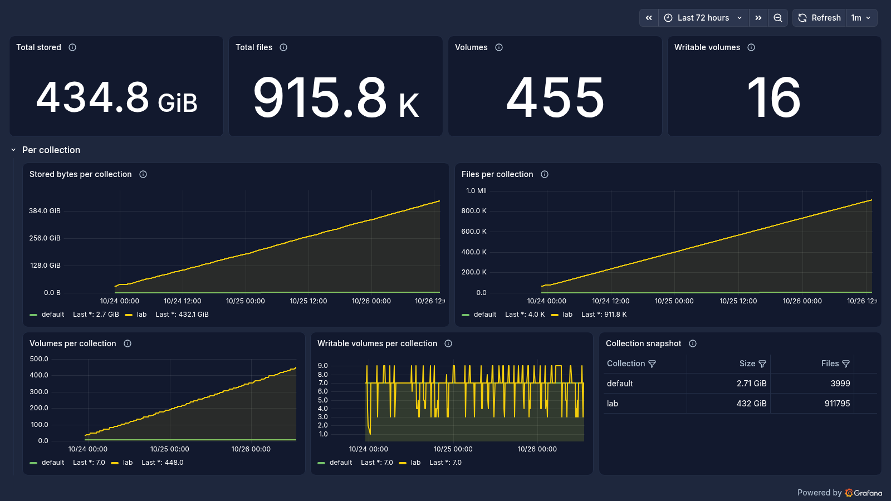
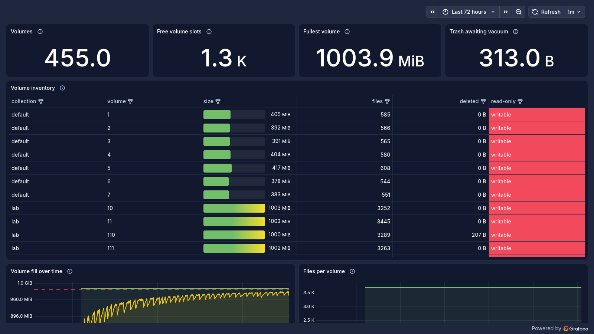

# Weekend report — 23–26 October 2026

Three days of telemetry on the lab's SeaweedFS tier: **+434 GB written, 455 volumes, 912k
chunks, no data loss** — and two capacity incidents that both ended with the same lesson
(volume *slots*, not disk space, is the limit that bites here).

Telemetry window: 2026-10-23 23:00 → 2026-10-26 13:20 UTC (62 h). Numbers below are from the
master's `/dir/status`, the volume server's `/status`, and the `telegraf` database.

## At a glance

| | value |
| --- | --- |
| Bucket `lab` | **464 GB** (911,933 chunks, 911,938 files) |
| Written this weekend | **+434 GB**, ≈ **7.0 GB/h** sustained |
| Volumes allocated | 455 of 1720 slots (**1265 free**) |
| Disk `/data1` (PVC, 220-slot budget) | 315 GB used · 175 GB free — **at its slot ceiling** |
| Disk `/misc` (hostPath, 1500-slot budget) | 340 GB used · **1.6 TB free** |
| Collections | `lab` (SeaweedFS objects) + `default` (filer metadata), 7 writable volumes each |
| Read-only volumes | 0 |
| Highest volume ID | 518 (455 live ⇒ 63 reclaimed by compaction/vacuum) |
| Ingestion coverage | 369 of 372 ten-minute bins — 30 min lost across the incidents |
| Compaction backlog (peak) | 9 snapshots · lag peak 116 s |

## Cluster overview

The shape of the weekend is the middle chart: `/misc` climbs from zero when the second disk
came online, while `/data1` plateaus once it hits its own 220-slot budget. Both are healthy;
what matters is the **Volume slots free** stat at top right — 1265 — because at zero the
filer returns `500 No writable volumes and no free volumes left` no matter how much disk is
left.

## Growth

Growth is dead linear at ~7 GB/h, which is Telegraf + InfluxDB 3 Enterprise WAL/Parquet for
five nodes, with no retention window in place. `lab` went from 30 GB to 464 GB in 62 hours.
Total files crossed 900k, which is why compaction and vacuum matter as much as capacity:
63 volumes have already been reclaimed behind the current 455.

## Per-volume view

Volumes fill to ~96% before the master hands out a new one (the sawtooth), and the fullest
is 1003.9 MiB against the 1000 MB limit — normal overshoot from concurrent appends. The
inventory table is where a single hot volume shows up.

## What broke, and what it cost

| time (UTC) | event |
| --- | --- |
| 23 Oct 18:30 | unpinned `helm upgrade` took chart 4.49.0, which pins `chrislusf/seaweedfs:4.49` — a tag that was never published (404). All six pods `ImagePullBackOff`, storage down. Rolled back to 4.48.0. |
| 23 Oct 19:33 | 35/35 slots exhausted by an earlier configuration: S3 PUTs returned 500 and the InfluxDB 3 ingester stalled. |
| 23 Oct 20:40 | `maxVolumes` 220 applied with the chart pinned; master grew volumes, ingestion resumed. |
| 23 Oct 23:30 | 46/46 again — the 220 value was on the wrong values path, so the release came back at 46. Alert fired at 4 free slots. |
| 24 Oct 00:41 | fixed properly; ingestion resumed within a minute of the rollout. |
| 24 Oct 16:40 | second data dir on a 1.8 TB disk (`/misc`), 1500 more slots, plus an initContainer that refuses to start if `/misc` is not a separate device. |
| 25–26 Oct | steady: ~7 GB/h, no alert, no restarts of any db3 or SeaweedFS pod. |

Both capacity incidents cost about 30 minutes of telemetry in total, and both were
misdiagnosed at first as disk problems — the disk was under 25% used each time. The volume
server runs `volumeSizeLimitMB: 1000`, so a slot is 1 GB, not the 30 GB the `weed` version
banner advertises; `maxVolumes` is therefore a **GB ceiling**, not a count of large volumes.

## Telemetry quality

- Ingest gaps: 369/372 ten-minute bins over the weekend. The missing three line up with the
  rollouts above, not with load.
- Telegraf: 0 ongoing write errors; the counter recorded 63 during the outages only.
- Compaction: backlog peaked at 9 uncompacted snapshots with 116 s of lag, then drained.
  Deferred snapshots stayed at 0 — the gate that stalls `--recover-deferred-snapshots` never
  engaged.
- No pod restarts in `s3` or `influxdb3` after Friday's work; the db3 processor shows 2
  restarts, both from the deliberate mode patches.

## Headroom, and the decision that is still open

At 7 GB/h, the 1265 free slots are about **7–8 days** of runway, and `/misc` has 1.6 TB free,
so the slot budget runs out before the disk does — the same asymmetry that caused both
outages.

Options, in the order I'd take them:

1. **Re-enable a retention window.** 8 h held ~50 GB; 7 days would hold roughly 1.1 TB, which
   fits `/misc` and makes slot consumption predictable. Removing retention is what turned a
   bounded system into a 7-day timer.
2. **Raise `volumeSizeLimitMB`** (e.g. 4000) rather than `maxVolumes` — same data, a quarter of
   the ids, and far less churn for the master and the vacuum worker.
3. **Keep the alert honest.** The threshold now fires at 50 free slots (~10 h at current
   burn); it was 5, which at 1720 slots was about an hour of warning.

Also outstanding from the config review: `/misc` has no `/etc/fstab` entry, so a reboot drops
the mount and the volume pod will (correctly) refuse to start until it is remounted.

---

Screenshots rendered server-side by the in-cluster Grafana image renderer (`/render/...`),
added to the Grafana release this weekend because the headless browser cannot keep a
dashboard tab visible long enough for the panels to paint.

Dashboards: `SeaweedFS — Cluster Overview`, `SeaweedFS — Collections & Growth`,
`SeaweedFS — Volumes`, all regenerable from `grafana/build_dashboards.py`.
